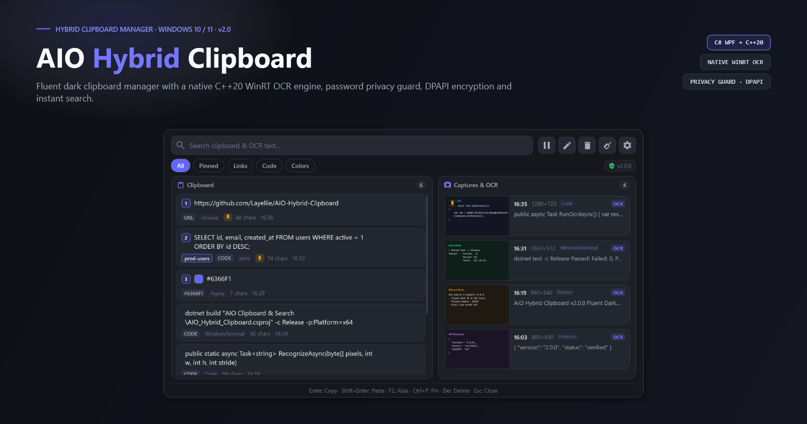
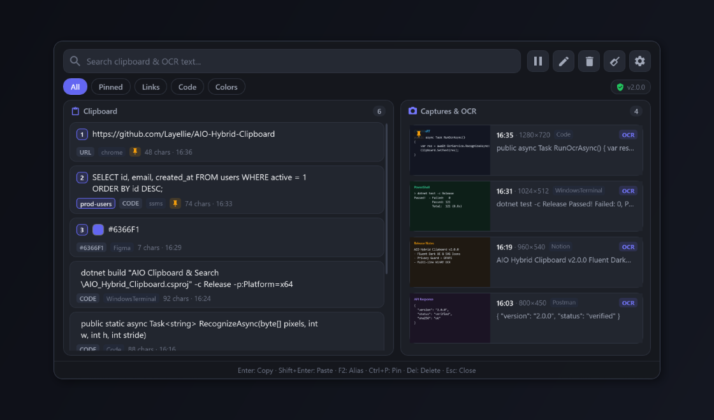

# AIO Hybrid Clipboard

**English** | [Türkçe](README.tr.md)



[](https://github.com/Layellie/AIO-Hybrid-Clipboard/actions/workflows/ci.yml)
[](https://github.com/Layellie/AIO-Hybrid-Clipboard/releases)
[](https://github.com/Layellie/AIO-Hybrid-Clipboard/releases/latest)


A lightweight, hybrid (C# WPF + C++20) clipboard manager for Windows. AIO Hybrid Clipboard tracks copied text and screenshots, classifies clipboard items automatically, protects password manager payloads, and runs a native C++ WinRT OCR engine to make every screenshot searchable.

## Installation

Download the latest `AIO_Hybrid_Clipboard_Setup_v*.exe` from [Releases](https://github.com/Layellie/AIO-Hybrid-Clipboard/releases/latest) and run it. The installer:

- Installs per-user (no admin rights or UAC prompt needed)
- Is self-contained (no .NET runtime installation required)
- Supports English and Turkish setup languages

## Features (v2.0.0)

- **Fluent Dark 2-Column UI:** Virtualized vertical clipboard feed on the left, 2-column screenshot and OCR gallery on the right, SVG icons, hover quick actions, and toast feedback.
- **Native C++20 WinRT OCR:** Preserves line breaks across multi-line captures, runs automatically in the background (toggleable), and decodes full-resolution PNGs on demand while keeping 320px low-RAM thumbnails in memory.
- **Smart Content Classification & Filters:** Automatically detects URLs (with one-click open in browser), Hex Colors (with live swatch preview), Emails, File Paths, and Code snippets. Filter instantly with `All / Pinned / Links / Code / Colors` pills.
- **Multi-Word & Typo-Tolerant Search:** Search across text history and extracted screenshot OCR text using multiple words with single-typo tolerance.
- **Privacy Guard & Incognito Mode:** Automatically ignores sensitive clipboard entries from password managers (`ExcludeClipboardContentFromMonitorProcessing`, `Clipboard Viewer Ignore`, `CanIncludeInClipboardHistory=0`). Pause monitoring anytime from the header or tray menu.
- **Auto-Paste & Full Keyboard Workflow:** Optional auto-paste returns focus to your previous app and pastes immediately. Navigate completely by keyboard (`Up`/`Down`, `Tab`, `Enter`, `Shift+Enter`, `Ctrl+P`, `Del`, `Ctrl+F`, `Esc`).
- **Multi-Monitor & Per-Monitor DPI Aware:** Always opens centered on the active monitor's work area without overlapping the taskbar, and dismisses when clicking outside.
- **SHA-256 Deduplication & Atomic Persistence:** Identical screenshots are promoted instead of duplicated on disk; session state auto-saves atomically (`.tmp -> Move`) with configurable history limits (`10..200`).
- **Quick-Paste Hotkeys & Drag-and-Drop:** Press `ALT+1/2/3` to paste recent entries from anywhere, drag screenshots directly into Discord, Photoshop, or Desktop, or copy full-res images back to the clipboard.
- **Hardened Auto-Updater:** Checks GitHub Releases over HTTPS with strict host and filename validation, download progress reporting, and one-click install.
- **System Tray & `--minimized` Startup:** Starts silently in the system tray with Windows, full EN/TR localization.

## Keyboard Shortcuts

| Action | Shortcut |
|---|---|
| Summon / hide launcher | `ALT + SPACE` (customizable) |
| Capture screen | `WIN + SHIFT + S` (Windows built-in) |
| Quick-paste entry 1 / 2 / 3 | `ALT + 1` / `ALT + 2` / `ALT + 3` |
| Focus search | `CTRL + F` |
| Switch between search, texts, captures | `TAB` / `SHIFT + TAB` |
| Copy selected text / Run OCR on capture | `ENTER` |
| Copy & auto-paste text / Copy capture image | `SHIFT + ENTER` |
| Pin / unpin selected item | `CTRL + P` or Right-click |
| Delete selected item(s) | `DEL` |
| Dismiss (Settings -> Search -> Hide) | `ESC` |

## How to Build

### Prerequisites

- [Visual Studio 2022](https://visualstudio.microsoft.com/) with:
  - **Desktop development with C++** workload (MSVC v143 toolset)
  - **.NET desktop development** workload
- [.NET 10 SDK](https://dotnet.microsoft.com/download/dotnet/10.0)
- Windows SDK 10.0 or later

### Steps

```bat
:: 1. Clone the repository
git clone https://github.com/Layellie/AIO-Hybrid-Clipboard.git
cd "AIO-Hybrid-Clipboard"

:: 2. Build the C++ OCR DLL first (x64 required)
msbuild "AIO_SearchEngine\AIO_SearchEngine.vcxproj" /p:Configuration=Release /p:Platform=x64

:: 3. Build the C# WPF application
dotnet build "AIO Clipboard & Search\AIO_Hybrid_Clipboard.csproj" -c Release -p:Platform=x64

:: 4. Run tests
dotnet test "AIO_Hybrid_Clipboard.Tests\AIO_Hybrid_Clipboard.Tests.csproj" -c Release
```

The post-build event automatically copies `AIO_SearchEngine.dll` into the C# output directory. The final binary is at:

```
AIO Clipboard & Search\bin\x64\Release\net10.0-windows\AIO_Hybrid_Clipboard.exe
```

> **Note:** The application must run as **x64** because the native OCR DLL is x64-only.

### Building the Installer

Requires [Inno Setup 6](https://jrsoftware.org/isinfo.php).

```bat
:: 1. Publish a self-contained build
dotnet publish "AIO Clipboard & Search\AIO_Hybrid_Clipboard.csproj" -c Release -r win-x64 --self-contained true -p:Platform=x64

:: 2. Copy the native OCR DLL into the publish folder
copy "AIO_SearchEngine\x64\Release\AIO_SearchEngine.dll" "AIO Clipboard & Search\bin\x64\Release\net10.0-windows\win-x64\publish\" /Y

:: 3. Compile the installer (output: installer\Output\)
"%ProgramFiles(x86)%\Inno Setup 6\ISCC.exe" installer\AIO_Hybrid_Clipboard.iss
```

## Tech Stack

| Layer | Technology |
|---|---|
| UI | C# / .NET 10 / WPF (Fluent Dark Theme) |
| OCR Engine | C++20 / WinRT (`Windows.Media.Ocr`) |
| Interop | P/Invoke (C-style DLL exports + Win32 Clipboard/Monitor APIs) |
| Persistence | Atomic `System.Text.Json` + Windows Registry |

## Architecture

The solution contains three projects:

- **`AIO Clipboard & Search/`** — WPF MVVM application (`MainViewModel`, `ContentClassifier`, `ClipboardPrivacyGuard`, `ClipboardService`, `HistoryService`, `HotkeyManager`, `OcrService`, `UpdateService`, `TrayIconService`, `SessionStore`, `SettingsService`, `StartupService`, `Log`) with a thin Win32 `MainWindow` and EN/TR `.resx` localization.
- **`AIO_SearchEngine/`** — Native C++ DLL exporting `ProcessImageOCR` and `IsOcrEngineAvailable`. Accepts raw premultiplied BGRA8 pixels, runs `OcrEngine::RecognizeAsync` via C++/WinRT with RAII apartment management, and returns line-structured text alongside a typed status code.
- **`AIO_Hybrid_Clipboard.Tests/`** — 121 xUnit unit and integration tests covering classification, privacy filtering, app exclusion, text transforms, DPAPI encryption, TTL expiration, SHA-256 update verification, deduplication, fuzzy search, debounce, huge-text bounds, frozen theme resources, localization parity, session persistence, and real native OCR.

## FAQ

**Windows SmartScreen warns me when running the installer. Why?**
The installer is not code-signed. The source is public and every release is built directly by GitHub Actions; click *More info -> Run anyway*. You can verify the SHA-256 digest listed on the release page.

**Where is my data stored?**
Everything stays local in `AIO_Cache/` next to the executable (history, thumbnails/PNGs, and `app.log`). The only network request is the GitHub Releases update check.

**Are passwords from password managers recorded?**
No. `ClipboardPrivacyGuard` checks standard Windows and cross-platform clipboard exclusion formats (`ExcludeClipboardContentFromMonitorProcessing`, `Clipboard Viewer Ignore`, `CanIncludeInClipboardHistory=0`) and skips them automatically.

**A hotkey doesn't work.**
Another app already registered that combination. Settings displays a conflict warning so you can pick a different combo right away.

## Changelog

See [CHANGELOG.md](CHANGELOG.md) for the full version history.

## Contributing

Contributions are welcome. Please read [CONTRIBUTING.md](CONTRIBUTING.md) first.

## License

[MIT](LICENSE) — © 2026 SAMET KAŞMER AKA LAYE77IE
