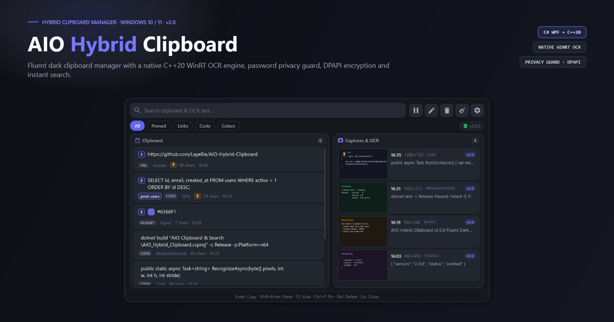
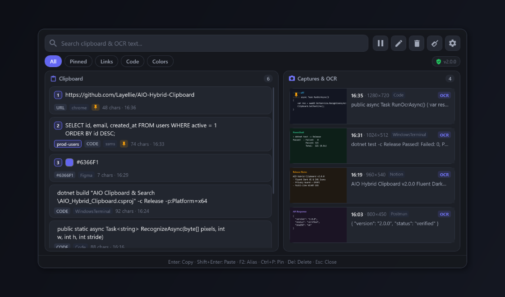

# AIO Hybrid Clipboard

[English](README.md) | **Türkçe**



[](https://github.com/Layellie/AIO-Hybrid-Clipboard/actions/workflows/ci.yml)
[](https://github.com/Layellie/AIO-Hybrid-Clipboard/releases)
[](https://github.com/Layellie/AIO-Hybrid-Clipboard/releases/latest)


Windows için hafif, hibrit (C# WPF + C++20) bir pano yöneticisi. Kopyaladığınız metinleri ve ekran görüntülerini takip eder, içerikleri otomatik sınıflandırır, şifre yöneticilerini gizlilik kalkanıyla yok sayar ve dahili C++ WinRT OCR motoruyla görsellerdeki metinleri aranabilir hale getirir.

## Kurulum

[Releases](https://github.com/Layellie/AIO-Hybrid-Clipboard/releases/latest) sayfasından en güncel `AIO_Hybrid_Clipboard_Setup_v*.exe` dosyasını indirip çalıştırın. Kurulum:

- Kullanıcı bazlıdır (yönetici izni / UAC gerektirmez)
- Kendi kendine yeterlidir (.NET kurulumu gerektirmez)
- Türkçe ve İngilizce kurulum dili destekler

## Özellikler (v2.0.0)

- **Modern Fluent Koyu Arayüz:** Solda sanallaştırılmış dikey metin listesi, sağda 2 sütunlu ekran görüntüsü ve OCR galerisi, SVG ikonlar, hover aksiyonları ve toast bildirimleri.
- **Yerel C++20 WinRT OCR:** Çok satırlı metinlerde satır sonlarını korur, yeni yakalamalarda arka planda otomatik çalışır (ayarlardan kapatılabilir) ve bellekte yalnızca 320px küçük resimler tutarken OCR sırasında diskteki tam çözünürlüklü PNG'yi okur.
- **Akıllı İçerik Sınıflandırma ve Filtreler:** URL (tek tıkla tarayıcıda açma), Hex Renk (canlı renk önizleme kutucuğu), E-posta, Dosya Yolu ve Kod parçacıklarını otomatik algılar. `Tümü / Sabitli / Bağlantı / Kod / Renk` filtreleriyle anında daraltır.
- **Çok Kelimeli ve Yazım Hatası Toleranslı Arama:** Hem metin geçmişinde hem de ekran görüntülerinden çıkarılan OCR metinlerinde birden fazla kelimeyle arama yapar.
- **Gizlilik Kalkanı ve Gizli Mod:** Şifre yöneticilerinin ve gizli pencerelerin kopyaladığı verileri (`ExcludeClipboardContentFromMonitorProcessing`, `Clipboard Viewer Ignore`, `CanIncludeInClipboardHistory=0`) otomatik olarak yok sayar. İstediğiniz an üst bardan veya sistem tepsisinden izlemeyi duraklatabilirsiniz.
- **Otomatik Yapıştırma ve Tam Klavye Navigasyonu:** Seçimde önceki pencereye otomatik odaklanıp yapıştırabilir. Fare kullanmadan `Yukarı/Aşağı`, `Tab`, `Enter`, `Shift+Enter`, `Ctrl+P`, `Del`, `Ctrl+F`, `Esc` ile yönetilebilir.
- **Çoklu Monitör ve DPI Desteği:** İmlecin bulunduğu aktif monitörün çalışma alanında (görev çubuğunu kapatmadan) ortalanarak açılır, dışarı tıklayınca gizlenir.
- **SHA-256 Tekilleştirme ve Atomik Oturum Kaydı:** Aynı ekran görüntüsü tekrar kopyalandığında diskte çoğaltılmaz; oturum verileri atomik (`.tmp -> Move`) ve gecikmeli olarak kaydedilir. Geçmiş limiti `10..200` arasında ayarlanabilir.
- **Hızlı Yapıştırma ve Sürükle-Bırak:** `ALT+1/2/3` ile son 3 kaydı doğrudan yapıştırın, görselleri Discord, Photoshop veya masaüstüne sürükleyin ya da panoya görsel olarak geri kopyalayın.
- **Güvenli Otomatik Güncelleme:** GitHub Releases üzerinden HTTPS ve kaynak alan adı doğrulamasıyla indirme ilerlemesini göstererek günceller.
- **Sistem Tepsisi ve `--minimized` Başlangıç:** Windows açılışında pencere göstermeden doğrudan sistem tepsisinde başlar. Tam Türkçe / İngilizce destek.

## Klavye Kısayolları

| Eylem | Kısayol |
|---|---|
| Başlatıcıyı aç / gizle | `ALT + SPACE` (özelleştirilebilir) |
| Ekran yakala | `WIN + SHIFT + S` (Windows yerleşik) |
| Hızlı yapıştır 1 / 2 / 3 | `ALT + 1` / `ALT + 2` / `ALT + 3` |
| Aramaya odaklan | `CTRL + F` |
| Arama, metinler ve yakalamalar arası geç | `TAB` / `SHIFT + TAB` |
| Seçili metni kopyala / Görselde OCR çalıştır | `ENTER` |
| Kopyala ve yapıştır / Görseli panoya kopyala | `SHIFT + ENTER` |
| Sabitle / sabitliği kaldır | `CTRL + P` veya Sağ tık |
| Seçili öğeleri sil | `DEL` |
| Kapat (Ayarlar -> Arama -> Gizle) | `ESC` |

## Derleme

Gereksinimler için [İngilizce README](README.md#how-to-build) ve [CONTRIBUTING.md](CONTRIBUTING.md) dosyalarına bakın.

```bat
:: 1. Önce C++ OCR DLL (x64 zorunlu)
msbuild "AIO_SearchEngine\AIO_SearchEngine.vcxproj" /p:Configuration=Release /p:Platform=x64

:: 2. Sonra C# WPF uygulaması
dotnet build "AIO Clipboard & Search\AIO_Hybrid_Clipboard.csproj" -c Release -p:Platform=x64

:: 3. Testler
dotnet test "AIO_Hybrid_Clipboard.Tests\AIO_Hybrid_Clipboard.Tests.csproj" -c Release
```

## SSS

**Kurulumda Windows SmartScreen uyarısı çıkıyor, neden?**
Kurulum dosyası kod imzalı değil. Kaynak kod tamamen açık ve her sürüm GitHub Actions üzerinden derleniyor; *Ek bilgi -> Yine de çalıştır* diyerek devam edebilirsiniz.

**Verilerim nerede saklanıyor?**
Her şey exe'nin yanındaki `AIO_Cache/` klasöründe yerel olarak tutulur. Tek ağ isteği GitHub Releases güncelleme denetimidir.

**Şifre yöneticisinden kopyaladığım parolalar kaydediliyor mu?**
Hayır. `ClipboardPrivacyGuard` standart Windows ve şifre yöneticisi dışlama formatlarını algılayarak bu içerikleri geçmişe almaz.

**Kısayolum çalışmıyor.**
Başka bir uygulama aynı kombinasyonu kaydetmiş olabilir. Ayarlar paneli çakışmayı doğrudan gösterir; farklı bir kombinasyon seçebilirsiniz.

## Sürüm Geçmişi

Tam geçmiş için [CHANGELOG.md](CHANGELOG.md).

## Katkıda Bulunma

Katkılar memnuniyetle karşılanır. Başlamadan önce [CONTRIBUTING.md](CONTRIBUTING.md) dosyasını okuyun.

## Lisans

[MIT](LICENSE) — © 2026 SAMET KAŞMER AKA LAYE77IE

Geliştiren: Samet Kaşmer · [layellie.dev](https://layellie.dev)
